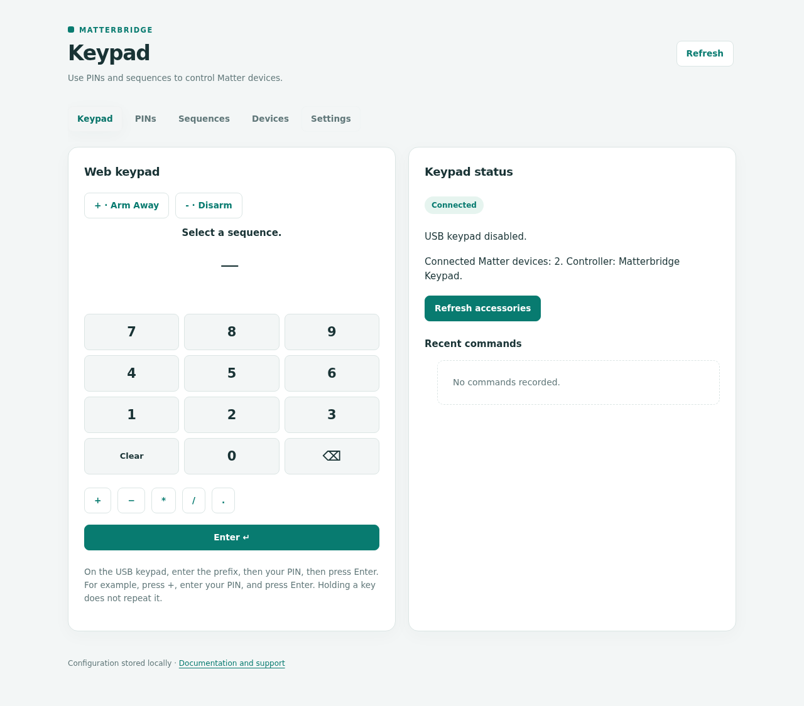

# Matterbridge Keypad

[](https://github.com/macjl/matterbridge-securitysystem-keypad/actions/workflows/ci.yml)

**Preview 0.2.0-alpha.2 · Apache-2.0 · Matterbridge ≥ 3.11.2 · Node.js 24 recommended**

A web keypad and optional Linux USB keypad that authorize local PINs and send Matter commands directly to paired devices.



## How it works

1. Share the devices to be controlled with the Keypad controller from their existing Matter controller.
2. Create named PINs with 4 to 12 digits. Leading zeros are allowed.
3. Create sequences with a unique prefix of 1 to 4 symbols from `+ - * / .`, authorized PINs, and commands in execution order.
4. Enter **prefix → PIN → Enter**, or select a sequence in the web keypad and then enter the PIN.

For example, use `+` for Away and `-` for Disarm. Backspace corrects a digit and Escape clears the entry. Web and USB entries are independent. The plugin salts and hashes PINs with scrypt. Entries expire, and failed attempts contribute to a shared lockout that survives restarts. A command error stops the sequence at that command. An On/Off command succeeds after the subscribed state confirms the requested value.

To control [Alarm](https://github.com/macjl/matterbridge-securitysystem-core), send **Turn on** to a mode endpoint or to Disarm. Authorize Matterbridge Keypad in the Alarm settings to let it disarm independently of Apple Home.

## USB keypad

USB input is optional. On Linux, build the evdev module with `npm run build:usb` using a C compiler and the Node.js and Linux headers. The Docker image builds the module for its architecture.

Pass a dedicated keypad using a mapping such as `--device /dev/input/by-id/DEVICE-event-kbd:/dev/input/alarm-keypad:r`. In **Settings**, enable USB input and choose `/dev/input/alarm-keypad`. Exclusive mode reserves the device for the plugin.

The reader supports 32-bit and 64-bit Linux evdev records, ignores held-key repeats, and clears input after disconnect or loss of synchronization. The web keypad remains available when the USB device is absent. Reconnecting USB may require recreating the container so Docker can pass through the new device node. Physical testing with a dedicated USB keypad is still pending.


## Local installation

```sh
git clone https://github.com/macjl/matterbridge-securitysystem-keypad.git
cd matterbridge-securitysystem-keypad
# Register the checkout with an existing Matterbridge installation.
matterbridge --add "$PWD"
```

Sign in to Matterbridge and open `/plugins/matterbridge-securitysystem-keypad/`. The web interface follows the browser’s preferred supported language, with English as the fallback. Matterbridge 3.11.2 or later provides authentication for the plugin API.


## Docker

```sh
docker build -t matterbridge-securitysystem-keypad:local .
docker compose up -d --no-build
```

The image uses Matterbridge 3.11.5 and stores configuration and pairings in `/data`. Keep that volume when replacing or rebuilding the container. HTTP defaults to port 8284 and Matter to UDP port 5545. Deployment parameters are `POC_HTTP_BIND`, `POC_HTTP_PORT`, `POC_MATTER_PORT`, `POC_MDNS_INTERFACE`, and `POC_DATA_DIR`.

To run all three plugins together, clone the repositories side by side. Run `scripts/build-stack.sh` from the Alarm repository and apply the Audio and Keypad `compose.stack.yaml` overrides. Each plugin also runs independently.


## Development and validation

```sh
npm ci
npm run check
npm test
npm pack --dry-run
```

CI checks the source, tests, and package on Node.js 24. Matterbridge supplies the Matter APIs at runtime. UI tests use simulated controllers, and network integration tests use disposable containers and storage.

With the full stack image built, run `KEYPAD_TEST_IMAGE=matterbridge-securitysystem-stack:local bash test/run-integration.sh` and `KEYPAD_TEST_IMAGE=matterbridge-securitysystem-stack:local bash test/run-auth.sh`. USB tests use simulated input.
